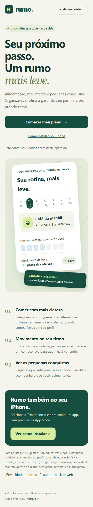
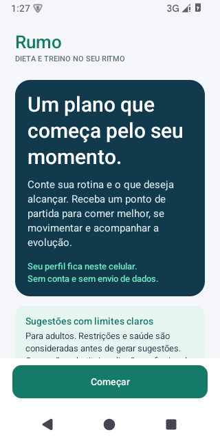

# Rumo · Dieta e treino

Aplicativo em português para organizar alimentação, atividade física e evolução a partir de um cadastro local. Disponível em Android e agora também como site instalável no iPhone, iPad e outros navegadores. Sem conta, anúncios ou API de inteligência artificial.

## Usar no iPhone ou pelo navegador

**[Abrir o Rumo Web](https://rumo-dieta-treino.ruddybatch.chatgpt.site)** · [Novidades 1.2.0](CHANGELOG.md) · [Código da versão web](web/)

No iPhone, abra no Safari → Compartilhar → Adicionar à Tela de Início → deixe Abrir como App da Web ativado se disponível → Adicionar. O próprio site mostra o passo a passo pelo botão **Instalar no celular**. Se a opção não aparecer, procure Editar Ações no menu Compartilhar.

Instale antes de preencher seu cadastro. O app instalado pode ter dados separados do Safari; use o backup web para transferir seu diário. Os dados ficam neste navegador/aparelho, sem sincronização com o APK ou outros dispositivos. Aguarde o aviso **Pronto para usar offline** no primeiro acesso. Limpar os dados ou remover o app pode apagar o histórico: exporte backups privados.



[Guia e desenvolvimento web](web/README.md) · [Verificações e limites de teste](web/VERIFICACAO.md)

## O que faz

- Apresentação e cadastro de peso, altura, idade, sexo opcional, atividade, experiência, objetivo, local de treino, alimentação e saúde.
- Sugestões para perder peso, manter condicionamento, ganhar força/massa ou começar a preparação para TAF.
- Quatro refeições por dia, com uma principal e duas alternativas compatíveis quando o catálogo cobre as restrições. Porções em gramas, medidas caseiras e estimativas de nutrientes.
- Filtros para vegetarianismo, veganismo, glúten, lactose e os alérgenos oferecidos no cadastro. Não certifica ausência de contaminação cruzada.
- Ciclo inicial de quatro semanas, com cinco dias de atividade e descanso na quarta e no domingo. Modalidade, duração e exercícios consideram experiência, objetivo, local, histórico articular e acesso/domínio de natação. Avanço manual.
- Peso, água, refeições e treino por data; histórico, edição de perfil, exportação e restauração de backup.
- Atualização da versão 1.0.0 com revisão do cadastro e preservação dos registros. Sugestões atuais ficam separadas dos treinos já registrados.

## Instalar



Android 8.0 ou superior. Baixe o APK em [Releases](https://github.com/saulomendess06-art/rumo-dieta-treino/releases), abra no celular e permita a instalação por esse aplicativo de arquivos/navegador se o Android solicitar. Para atualizar, instale por cima da versão anterior; exporte um backup antes de trocar de aparelho ou desinstalar.

## Limites das sugestões

O aplicativo fornece organização e um ponto de partida educativo. Não faz diagnóstico, prescrição clínica, tratamento ou reabilitação e não garante resultados físicos, perda de peso ou aprovação em TAF.

A geração alimentar automática atende adultos com dados dentro das faixas do modelo. Condições clínicas relevantes, gestação/amamentação, informações de saúde não reconhecidas, baixo peso, sexo não informado ou estimativa fora da faixa coberta não recebem meta automática. Restrições alimentares livres também pedem revisão, em vez de serem ignoradas. O diário continua disponível. Se faltarem três preparações equivalentes compatíveis, a refeição é identificada como dependente de ajuste profissional.

As sugestões e filtros não substituem nutricionista ou avaliação de saúde/exercícios. Confira rótulos, ingredientes e contaminação cruzada em alergias ou doença celíaca. Leia [as regras do modelo](docs/modelo.md).

## Privacidade

O APK não solicita permissão de internet. Perfil e registros ficam no armazenamento privado do aplicativo. Arquivos só saem por ação explícita no seletor de documentos do Android. Backups contêm informações pessoais e devem ser guardados em local privado. Não há painel administrativo com dados dos usuários.

Veja a [política de privacidade](PRIVACIDADE.md). Nenhum perfil de uma pessoa real, credencial ou chave de assinatura integra o código público. Os perfis dos testes são fictícios.

## Compilar no Windows

Requisitos: JDK 17, Android SDK Platform 36, Build Tools 36.0.0, Python 3 e PowerShell. Não precisa de Gradle ou dependências de rede.

```powershell
.\build.ps1 -SdkPath 'C:\Android\Sdk' -JdkPath 'C:\Java\jdk-17' -PrivatePath 'C:\AssinaturaRumo'
```

Resultado: `build/Rumo-1.1.0.apk`, assinado e verificado. Se não existir chave na pasta privada, o script cria uma. Preserve-a para futuras atualizações; ela não deve ser enviada ao GitHub. Uma compilação com outra chave não instala por cima do APK distribuído com a chave original.

Use `-TestApk` para gerar separadamente o APK de testes. Ele não é necessário para usar o aplicativo.

## Código e testes

- `Planner.java`: estimativas, elegibilidade e regras alimentares sem dependência do Android.
- `Recommendations.java`: seleção e ajuste de preparações, filtros e rotina semanal.
- `Onboarding.java`: apresentação, cadastro e revisão.
- `Store.java`: persistência, migração, versões dos perfis e backup.
- `MainActivity.java` / `Ui.java`: telas, ações, componentes e gráfico.
- `assets/plan.json`: catálogo genérico; `legacy-plan.json` preserva o contexto dos registros da versão anterior.

```powershell
.\tests\run.ps1 -JdkPath 'C:\Java\jdk-17'
```

Os testes Android (`ProfileProbe`, `BackupProbe` e `HistoryProbe`) rodam por instrumentação após instalar o APK e `build/tests.apk` em um emulador. Exemplo:

```text
adb -s emulator-5580 shell am instrument -w br.com.saulo.rumoaotaf.test/br.com.saulo.rumoaotaf.test.ProfileProbe
```

`python tests/public_smoke.py CAMINHO_ADB` verifica o cadastro e os fluxos pela interface. Esse teste apaga dados apenas do aplicativo no emulador dedicado `emulator-5580`; não o execute em aparelho pessoal.

Para regenerar os catálogos: `python tools/make_plan.py` e depois `python tools/make_catalog.py`.

## Fontes

- [TACO, 4ª edição, NEPA/Unicamp (2011)](https://nepa.unicamp.br/publicacoes/tabela-taco-pdf/): composição dos alimentos. Dados reproduzidos com atribuição, conforme autorização da publicação; números dos alimentos disponíveis no catálogo e no aplicativo.
- [Mifflin–St Jeor (1990)](https://pubmed.ncbi.nlm.nih.gov/2305711/): estimativa de energia em repouso.
- [NIDDK — limites do planejamento de peso](https://www.niddk.nih.gov/health-information/weight-management/body-weight-planner).
- [CDC — começar atividade física](https://www.cdc.gov/healthy-weight-growth/physical-activity/getting-started.html).
- [Ministério da Saúde — Guia Alimentar](https://bvsms.saude.gov.br/bvs/publicacoes/guia_alimentar_populacao_brasileira_2ed_atualizada.pdf).

As fontes fundamentam princípios gerais e dados de alimentos. Não representam validação clínica do aplicativo ou de suas regras específicas.
